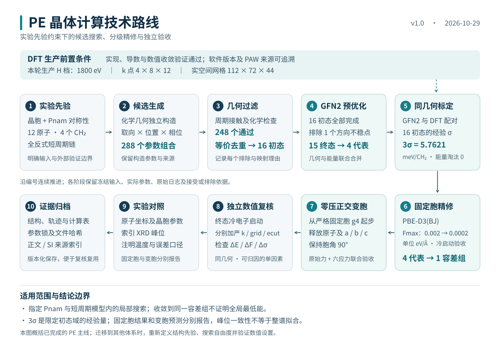

# PE 晶体结构重建与分层精修技术路线

版本 v1.0　固化日期 2026 年 10 月 29 日　项目根目录 `E:/PE_DFT`

本路线将 PE 计算固定为聚合物晶体研究的典型流程：以明确的化学和晶体学先验构造候选，用低成本模型完成预优化，以同几何 DFT 计算评估相对能误差，再通过多代表精修、变胞优化、独立数值验收和实验对照形成可追溯的结果。PE 已完成这一主线；它支持指定先验和搜索域内的结构重建与局部优化，不构成无先验全局晶体预测。

**固定流程及验收口径，保留 PE 专用参数的适用范围。** 后续复用沿用此阶段框架；原计算输入、结果与参数发布记录保持原样。本文中的“必须”是该路线的执行和报告规则，不表示新增量化任务已获安排。

## 1 技术路线总览



主线按输入冻结、候选生成、GFN2 预优化、同几何标定、固定胞 DFT 精修、代表变胞、实验对照与归档推进。DFT 方法及数值验证可与候选准备并行，但须先于正式 DFT 标定及精修完成。

| 阶段 | 固定操作与输出 | PE 已完成实例 | 进入下一阶段的条件 |
| --- | --- | --- | --- |
| S0 输入冻结 | 登记组成、晶胞、空间群、链周期、自由度、来源和结构哈希；标明生成输入与验证数据 | C4H8，12 原子，4 CH2；Pnam；实验胞 | 单位、轴序、周期成键图和来源核对通过 |
| S1 候选生成 | 从化学几何构造，在声明的参数网格枚举；记录每个候选 | 36 角 × 4 链轴位置 × 2 相位 = 288 | 周期闭合、化学连通性和对称性通过 |
| S2 过滤与去重 | 非键接触检查；按周期边界、同元素映射和晶体对称性去重 | 248 几何通过；16 独特存活初态 | 每次排除有原因，每次合并有映射 |
| S3 GFN2 预优化 | 粗到精周期采样；独立终态电子核验；代表加密；高对称驻点作方向检查 | 16 完成；排除 1 个方向不稳驻点；15 条终态合并为 4 代表 | 原始力、采样和几何检查通过 |
| N DFT 数值验证 | 验证能量与力/应力导数、SCF 噪声、截断能、k 点、网格及代表几何迁移 | 三方法验证；发布锁和后续生产参数留档 | 有明确适用域、差分阈值和通过记录 |
| S4 同几何标定 | 固定坐标与晶胞，统一相对能参考；初态误差统计与终态方法比较分开 | 21 套几何；29 DFT 配对；16 初态经验 σ | 配对身份、单位、数值精度与统计口径一致 |
| S5 固定胞 DFT 精修 | 所有代表在同一方法下优化；严格力门槛、冷启动、全体两两比较 | 4 代表经 0.002 → 0.0002 eV/Å 精修，归为 1 容差组 | 原始力、SCF、固定胞、对称性和组内每一对合并条件通过 |
| S6 代表变胞 | 从已验收固定胞终态出发，释放明确的胞自由度和内部原子 | g4 零压正交变胞完成 | 原始力和六应力分量联合通过；独立冷启动通过 |
| S7 末态复核与实验对照 | 分别加严 k 点、网格、截断能；分别比较坐标、胞长和索引峰位 | g4 三项复核通过；固定胞和变胞结果分别报告 | 比较结构身份、温度、波长、原子映射清楚 |
| S8 归档 | 保存协议、软件、结构、轨迹、结果、失败/取消状态和文件哈希 | 已有正文与 SI 数据包，路线索引指向原文件 | 关键结论能追到原始证据；未完成项不计为结果 |

这一顺序是复用时的逻辑依赖。历史参数校准、候选优化与标定曾分批推进，不能据此把不同批次几何或参数拼成同一次运行。

## 2 输入和搜索域

PE 基线采用两条沿 c 轴的无限全反式链，周期胞为 C4H8。固定胞 a/b/c = 7.432/4.929/2.545 Å，三角均为 90°；Pnam 为 No.62、Hall 297，使用 8 个对称操作。该晶胞和空间群来自 Tashiro 文献先验。生成器以 C—C = 1.54 Å、C—H = 1.09 Å 构造原子，不读取文献精修坐标或实验 setting 角。

setting 角定义为链平面在 ab 平面的投影相对 +a 的角度，不能与链内扭转角混用。枚举 0–175°、步长 5°，搭配 4 个半格横向链轴位置和碳镜面相位 1/4、3/4。两碳纯平移短周期排除了不能闭合的 gauche 构象；此结论不推广到长周期缺陷。

非键接触取 Bondi 半径 C = 1.70 Å、H = 1.20 Å 的和乘 0.85；C···C、C···H、H···H 门槛分别为 2.89、2.465、2.04 Å。排除周期化学图距离为 1 或 2 条键的近邻，另查链间 C···C ≥ 3.4 Å。

**数量链固定为：288 枚举 → 248 接触通过 → 16 等价去重后初态 → 16 GFN2 完成 → 15 排除方向不稳后终态 → 4 GFN2 代表 → 1 严格固定胞 DFT 容差组。** 其中 40 个组合被接触阈值排除，232 个为等价表示；它们不是能量筛除。

80–100°的 40 个组合在预筛被排除；独立的 80/85/90°类未进行量化优化。0.85 改成 0.80 时独特存活初态可由 16 增至 19，因此 75°是当前阈值形成的边界，并非对称性的普适上限。有限网格覆盖也不等于连续取向空间穷尽。补充输入仅保留为未运行分支，不列为本版必做任务。

## 3 PE 数值基线

### 3.1 GFN2 预优化

| 项目 | 固定的 PE 实例设置 |
| --- | --- |
| 实现 | tblite 0.7.0 的 GFN2-xTB，经 ASE 调用；不是独立 xtb.exe |
| 周期采样 | Γ 重复超胞；复制数不写成显式 k 点网格 |
| 粗阶段 | 2×2×6，accuracy = 0.01，原始 Fmax 目标 0.03 eV/Å |
| 精阶段 | 2×3×8，accuracy = 0.01，原始 Fmax 目标 < 0.01 eV/Å；固定胞、Pnam 投影 |
| 终态复核 | accuracy = 0.001 冷启动；代表用 3×4×10 同几何加密 |
| 加密验收 | 每 CH2 能差 < 1 meV，最大原子力矢量差 < 0.005 eV/Å，加密自身 Fmax < 0.01 eV/Å |
| 电子占据 | 优化为 300 K；标定生产为 0 K；两者都不是有限温度原子动力学 |
| 标定生产 | 冻结几何，2×3×8，accuracy = 0.001，max_iterations = 1000，中性闭壳层 |

若更密采样的自身原始力超出目标，应继续优化并对新几何重新验收。PE 中 cand_0025、cand_0065 曾追加至 0.003 eV/Å，不能将旧几何的加密检查移用到新终态。原胞能量按复制数归一，原胞力按等价副本平均，同时保留原始力、投影力和副本偏差。

GFN2 代表为 g1/cand_0025、g2/cand_0113、g3/cand_0041、g4/cand_0081。0°驻点虽小力，沿保持目标对称性的 ±1°扰动两侧能量均下降，故单列排除。该方向检查没有替代完整声子或 Hessian 分析。

### 3.2 DFT 方法和参数

主线使用 **GPAW 26.7.0 legacy CPU 平面波、原生 C/H PBE PAW、PBE-D3(BJ)+ATM**。optB88-vdW 和 r²SCAN-D4 用于数值验证及四个 GFN2 冻结终态的单点方法比较。正式数据不是 GPU 结果，也不是 QE/SSSP-UPF 结果。

| 层级或控制项 | PE 基线 |
| --- | --- |
| 历史数值发布 L 档 | 1400 eV；Γ 中心 3×6×9；gpts 96×60×36 |
| 本路线生产 H 档 | **1800 eV；Γ 中心 4×8×12；gpts 112×72×44** |
| 标定 U 档抽查 | 2000 eV；5×10×15；128×80×48；用于指定冻结几何迁移检查 |
| 固定电子设置 | 16 bands，展宽 0，XC stencil = 4，生产点群开启 |
| SCF 门槛 | 能量 1e−9 eV/electron；密度 1e−9 electron/electron；本征态 1e−11 eV²/electron |
| 并行 | 每任务 4 MPI ranks；历史固定胞批次最多 2 任务并发 |
| 数值加密差值基准 | 能量绝对差 ≤ 0.5 meV/atom；最大原子力矢量差 ≤ 0.005 eV/Å；六应力分量最大绝对差 ≤ 0.1 kbar；在新 g4 末态检查中作为历史差值诊断 |
| 固定胞优化 | FixSymmetry + LBFGS；maxstep = 0.05 Å；maxsteps = 200 |
| 固定胞两轮力目标 | 常规 ≤ 0.002 eV/Å；严格 ≤ 0.0002 eV/Å；均用未投影原始 Fmax |
| 变胞优化 | FixSymmetry + FrechetCellFilter + LBFGS；外压 0；mask = [1,1,1,0,0,0] |
| 变胞终态验收 | 原始 Fmax ≤ 0.002 eV/Å 且 max 六应力绝对值 ≤ 0.05 kbar；角度保持 90° |

这里的 H 档是后续实际生产设置；它不覆盖或改写早期 L 档发布锁。加密差值诊断不能替代或放宽各阶段原始 Fmax 与应力绝对门槛；有限差分导数验证另按其原协议。导数探针、早期参考变胞和正式生产有各自网格及用途，应引用对应输入。D3 截断、阻尼、ATM、PAW 哈希及软件依赖以来源清单中的原始参数锁为准；optB88-vdW 不额外叠加 D3/D4。

能量统一标单位和归一口径：本 PE 胞含 12 atoms、4 CH2，不能把 meV/atom 与 meV/CH2 混用。应力采用 ASE 拉伸为正，Voigt 次序 xx、yy、zz、yz、xz、xy。固定胞应力只记录，不作零压验收；变胞则必须同时满足力和应力。

### 3.3 终态合并规则

在允许的周期映射、原点平移、正交反射和同元素置换中，**同一映射**同时满足周期 RMS ≤ 0.02 Å、最大单原子位移 ≤ 0.05 Å；同方法能差 ≤ 1 meV/CH2，才可合并。空间群相同或能量接近不能单独证明等价。

严格固定胞 DFT 使用全部六对比较与完整链接分组，组内每一对均须通过；不把 A 接近 B、B 接近 C 自动当作 A 接近 C。GFN2 历史分组按其原始实现保留，不追认其采用了 DFT 的完整链接算法。

## 4 同几何标定与代表保留

同一配对必须使用完全相同的坐标和晶胞。以 final_group_001 的 GFN2 冻结几何为共同参考身份 R0，但各方法采用自己的参考能量：

```text
ΔE_i(M) = 1000 × [E_i(M) − E_R0(M)] / 4             单位 meV/CH2
e_i = ΔE_i(DFT) − ΔE_i(GFN2)
b = mean(e_i)
σ = std(e_i, ddof=1)
均值校正预测 = ΔE_i(GFN2) + b
```

均值校正式用于声明的初态样本；R0 按定义在两方法中均为零，不机械加 b。统一平移不改变样本之间的能差或排序。

21 套冻结几何由 16 初态、4 代表终态、1 个不稳定驻点对照构成；PBE-D3(BJ) 21 点，加另两种泛函各 4 点，共 29 个 DFT 生产配对。**主统计只用 16 初态**，得到 b = 4.638334、σ = 1.920698、3σ = 5.762093 meV/CH2。

适用域限定为 PE C4H8、上述固定胞、相同全反式构造和 0–75°每 5°初态网格。σ 是同批样本描述量；不承诺 99.73% 的外推覆盖，不直接移用于优化终态、变胞、缺陷或其他聚合物。按已采用的分析口径，独立覆盖验证和实际节省 DFT 次数不构成本版经验 σ 的必需交付物。

本轮未指定低能窗口 W，**自动能量淘汰数为 0，四代表全部进入 DFT 精修**。16→4 的变化来自方向检查和联合合并。未来若启用能量筛选，应另版本明确适用域、参考、W、保留规则及边界案例；不能追溯改写本轮统计。能量误差较小也不能替代 DFT 力验收。

## 5 两种终态分别验收

| 结构身份 | 用途和结果 | 科学含义 |
| --- | --- | --- |
| 严格固定胞 g4 | a/b/c = 7.432/4.929/2.545 Å；Fmax = 0.000171616 eV/Å；setting 角约 45.74867° | 给定实验胞中的原子位置精修；不是零压平衡胞 |
| 新变胞 g4 | a/b/c = 7.129506/4.908356/2.555579 Å；冷验收 Fmax = 0.000620992 eV/Å；max 应力 = 0.011392944 kbar | 在 Pnam、正交及静态零外压条件下的局部优化胞 |

严格固定胞四个代表全通过，六对均可合并；最大两两 RMS 为 0.000324747 Å。g4 是该容差组的记录代表，其微小能量优势不支持独立晶型排序。

变胞从已验收的固定胞 g4 出发，同时释放原子和独立 a、b、c 轴长，不作恒体积或等比例缩放。变胞的 0.002 eV/Å 力门槛比严格固定胞宽 10 倍，不能将两者都写作 0.0002 eV/Å。

新变胞末态独立冷启动不继承电子密度和波函数，随后在同一冻结几何上做三项检查：k = 5×10×15；gpts = 128×80×48；Ecut = 2000 eV。**截断能比较使用同为 128×80×48 的 grid_only 点为基线**，避免把同时改变网格和截断能称为单因素检查。三项都通过；这些是末态单点复核，不是在加严设置下重新优化。

早期从文献坐标起步的两档变胞属于数值验证；它与本节两个终态分开命名、存储及比较。

## 6 实验对照和结论范围

坐标比较先统一轴序和原点，使用周期最小镜像及同元素一一匹配；报告 C、H 分项和全原子误差。固定胞 g4 对 Tashiro 坐标的全 12 原子 RMS 为 0.026947 Å、最大三维偏差为 0.039811 Å。文献 H 坐标含几何约束，不能将其视作无误差的独立真值。

静态变胞结果可与明确温度的低温晶胞比较，但不等于包括零点振动与热膨胀的预测。4.5 K 参考胞为 7.128/4.852/2.553 Å，新变胞逐轴相对差约 +0.0211%、+1.1615%、+0.1010%。Tashiro 的测量温度尚未核实，不贴“室温”标签。

XRD 对照使用 59 行 hkl 索引、45 个不同印刷 d 值，Mo Kα 波长 0.71073 Å。固定胞与新变胞的平均绝对相对 d 偏差分别为 0.287906% 和 1.647915%；保留变胞在这组峰位对照中没有改善的结果。固定胞峰位接近受到实验晶胞先验影响，不能独立验证原子坐标。

缺少实测连续强度谱，因此不报告 Rwp 或整谱拟合 R²，也不把 1 减峰位偏差转换成“整谱匹配度”。对照要区分原子坐标、晶胞和索引峰位三种证据。

本版最强结论为：**在指定 PE 化学拓扑、实验胞和 Pnam 先验及有限候选空间内，多起点经分层优化收敛到一个严格固定胞容差组；其代表完成了零压正交变胞和独立数值验收。** 未计算声子、完整 Hessian、零点能或有限温度核自由能；未对最终 g4 完成跨泛函几何优化，因此不声称全局最低能、动力学稳定或通用晶型预测成功。

## 7 复用规则与版本管理

可迁移的是先验显式化、候选覆盖记录、几何与能量联合筛选、同几何标定、数值验证、原始力/应力验收、结构身份分离和全程溯源。迁移到其他聚合物时，要重新确定链构象/周期、晶胞和空间群、搜索变量、接触门槛、采样密度、赝势/PAW、截断能、电子设置、力目标和 σ 适用域，不能直接复制 PE 数值。

每个新项目在计算前填写[验收清单](验收清单.md)，并保存独立的材料参数与来源记录。SCF、几何、原始力或文件完整性失败时，保留失败输出和原因；修复后新建 attempt，重新验收，不静默放宽阈值或覆盖旧结果。

本版为可引用的路线基线。文字澄清可发布 v1.0.x；数值参数、阈值、样本域或阶段定义变化发布 v1.1 及后续版本，并记录变化原因、受影响结构与新增验收。新增材料、空间群或长周期模型使用单独实例，不能使 PE v1.0 自动获得更大的科学适用域。原始运行输入与验收结果决定历史计算事实；本路线规定复用方法，两者有冲突时先核查并修订路线，不能改写原始证据。

PBE0 单点为用户取消、0 个有效终能；DREIDING→DFTB 公平对照正式优化启动数为 0；80/85/90°补充输入未运行。这些不是本版已完成主线或默认续跑任务。九月 XRD 辅助搜索、QE/DFTB 及云端探索保留在历史对照中。

## 8 交付和证据入口

| 内容 | 项目内权威入口 |
| --- | --- |
| 候选与 GFN2 | [生成协议](../../calculations/pe_pnam_candidates_20261020/protocol.json)、[候选总表](../../calculations/pe_pnam_candidates_20261020/candidate_catalog.csv)、[预优化汇总](../../calculations/pe_pnam_candidates_20261020/optimization_summary.json) |
| DFT 数值基准 | [原始参数发布锁](../../calculations/pe_gpaw_convergence_20261020/releases/20261021T043247_514339Z/parameters_lock.json)、[发布验收](../../calculations/pe_gpaw_convergence_20261020/releases/20261021T043247_514339Z/release_check.json) |
| 标定与解释口径 | [标定协议](../../calculations/pe_gfn2_dft_calibration_20261021/protocol.json)、[分析口径](../../calculations/pe_gfn2_dft_calibration_20261021/analysis_policy.json)、[16 初态标定表](../PE_GFN2_3sigma_20261021/data/initial_16_energy_calibration.csv) |
| 固定胞常规与严格精修 | [常规结果](../../calculations/pe_dft_representative_refinement_20261022/tables/final_energy_results.csv)、[严格协议](../../calculations/pe_dft_tight_force_refinement_20261022/protocol.json)、[严格结果](../../calculations/pe_dft_tight_force_refinement_20261022/tables/final_energy_results.csv)、[六对比较](../../calculations/pe_dft_tight_force_refinement_20261022/tables/pairwise_geometry_energy.csv) |
| g4 新变胞 | [变胞协议](../../calculations/pe_g4_variable_cell_20261027/protocol.json)、[冷验收](../../calculations/pe_g4_variable_cell_20261027/final_cold_verification.json)、[数值复核](../../calculations/pe_g4_variable_cell_20261027/convergence_checks/independent_review.json) |
| 搜索域说明 | [全取向及阈值敏感性](../pe_questions_audit_20261028/全取向角覆盖与阈值敏感性.md)、[未运行补充输入](../pe_questions_audit_20261028/supplemental_angles_080_085_090/README_补充输入说明.md) |
| 实验对照及完整技术汇总 | [10 月 29 日补充版](../PE技术文档_正文与SI_20261028/outputs/PE技术文档_正文与SI_固定胞结果补充版_20261029.md)、[固定胞速览](../PE技术文档_正文与SI_20261028/outputs/固定晶胞结果速览_20261029.md) |
| 本路线参数及可追溯性 | [route_lock.json](route_lock.json)、[source_manifest.json](source_manifest.json)、[validation.json](validation.json) |

正式交付至少包含输入与结构来源、候选及失败原因表、冻结方法参数、关键终态 CIF/POSCAR/坐标、能量/力/应力表、合并映射、终态验收、实验对照和来源哈希。轨迹、逐 SCF 记录和大体积重启文件保留原目录，以索引追溯；本路线文件包不是自足的量化计算运行环境。

## 9 可直接用于技术路线说明的表述

本研究以聚乙烯晶体为典型对象，建立基于化学与晶体学先验的结构重建和分层精修流程。在已知晶胞、空间群及链周期条件下，依据化学几何生成对称性约束候选，经周期接触检查和晶体等价去重后，采用周期 GFN2-xTB 预优化并保留非等价代表。在数值收敛验证基础上，通过同几何 DFT 单点计算量化低成本模型在声明初态域内的相对能误差，并采用统一 PBE-D3(BJ) 参数对全部代表进行固定胞精修。结合独立冷启动及几何和能量联合判据确定终态容差组，进一步对组代表开展零压正交变胞优化，以原始力、应力和独立加密检查联合验收。最终分别对照原子坐标、低温晶胞和 XRD 索引峰位，并归档参数、结构及完整证据链。PE 实例中四个预优化代表经严格固定胞精修归为一个容差组；经验 3σ 仅描述限定初态域的能量误差，本轮未据此淘汰候选。
